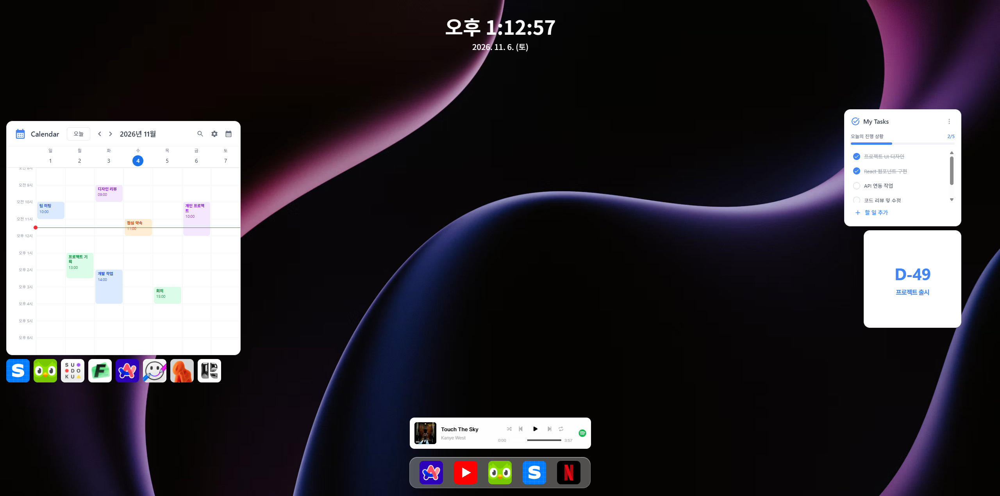

<h1 align="center">Movo Dashboard</h1>

<!-- <p align="center">
  
</p> -->

<p align="center">
  
  
  
  
  
  
  
</p>

<p align="center">
  <strong>필요한 정보를 한 화면에 모아 보고, 원하는 위치에 자유롭게 배치하세요.</strong>
</p>

<p align="center">
  <a href="https://dashboard-extension-rosy.vercel.app/" target="_blank">데모</a> ·
  <a href="">스토리북</a>
</p>

## 프로젝트 소개

Movo Dashboard는 Chrome 새 탭에서 사용할 수 있는 위젯 대시보드입니다. 시계, 빠른 링크, 이미지와 같은 위젯을 한 화면에 배치하고, 드래그 앤 드롭으로 원하는 위치에 정리할 수 있습니다.

위젯 위치는 브라우저의 `localStorage`에 저장되므로 새로고침 후에도 사용자가 구성한 레이아웃을 유지합니다.

## 주요 기능

- 위젯 기반 대시보드 레이아웃
- 위젯 드래그 및 5px 단위 그리드 스냅
- 위젯 간 충돌 방지 및 빈 위치 탐색
- 컨테이너 크기와 위젯 크기를 감지하는 반응형 위치 조정
- 위젯을 컨테이너 가로 중앙에 맞추는 자석형 중앙 스냅
- `localStorage` 기반 위젯 위치 저장
- 내부 위젯과 외부 서비스 위젯을 확장할 수 있는 구조

## 제공 위젯

### 내부 위젯

- 디지털 시계
- 디데이 위젯
- 빠른 링크 위젯
- 뽀모도로 타이머
- 이미지 및 갤러리 위젯

### 외부 위젯

- GitHub
- Gmail
- Google Calendar
- Spotify

> 위젯은 계속 추가될 예정입니다. 새로운 위젯이 추가되면 이 문서에도 반영합니다.

## 설치

1. [Releases](../../releases)에서 최신 릴리스 압축 파일을 내려받습니다.
2. 압축 파일을 해제합니다.
3. Chrome에서 `chrome://extensions`를 엽니다.
4. 우측 상단의 **개발자 모드**를 활성화합니다.
5. **압축해제된 확장 프로그램을 로드**를 선택합니다.
6. `manifest.json` 파일이 있는 폴더를 선택합니다.

## 개발 환경 실행

### 사전 요구 사항

- Node.js 20 이상
- npm

### 설치 및 실행

```bash
npm install
npm run dev
```

### 사용 가능한 명령어

| 명령어                    | 설명                             |
| ------------------------- | -------------------------------- |
| `npm run dev`             | Vite 개발 서버 실행              |
| `npm run build`           | TypeScript 검사 및 프로덕션 빌드 |
| `npm run lint`            | ESLint 검사                      |
| `npm run preview`         | 프로덕션 빌드 미리보기           |
| `npm run storybook`       | Storybook 개발 서버 실행         |
| `npm run build-storybook` | Storybook 정적 빌드              |

Chrome 확장 프로그램으로 확인하려면 먼저 `npm run build`를 실행한 다음, 생성된 `dist` 폴더를 [설치](#설치) 절차에 따라 로드합니다.

## 프로젝트 구조

```text
src/
├── components/
│   ├── Body/       # 대시보드와 위젯 배치 로직
│   ├── Footer/     # 하단 네비게이션
│   └── Widgets/    # 개별 위젯 컴포넌트
├── assets/         # 이미지와 폰트
├── data/           # 위젯에 사용하는 정적 데이터
└── stories/        # Storybook 스토리
```

## 화면 예시


---
