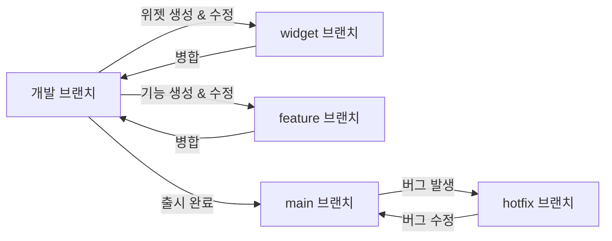

# 개발 컨벤션 문서

> 이 문서를 살펴보면서 요구사항에 맞게 개발을 진행하였는지 확인하세요.

## 브랜치 구조

브랜치는 `git-flow` 전략을 채택합니다.

- `main` : 제품이 정상적으로 동작하며 출시가 완료된 브랜치
- `develop` : 다음 버전의 제품 출시를 위한 개발 브랜치 (개발 통합이 되는 곳)
- `feat/기능 이름` : 기능을 개발하기 위한 브랜치 (설정, 위젯 속도 등)
- `widget/위젯 이름` : 위젯을 개발하기 위한 브랜치
- `hotfix` : main 브랜치에서 발생한 버그를 수정하기 위한 브랜치

개발 중 발생한 버그는 [ISSUE 생성] -> [새 브랜치 생성] -> [브랜치에서 작업] 순으로 진행합니다.<br>
수정된 버그는 `develop` 브랜치와 병합합니다.



## 폴더 구조

- `assets` : 이미지, 폰트 등 파일 관련
- `componets` : 위젯, 타이틀 등 컴포넌트 UI,UX를 구현하는 곳
- `data` : 가짜 데이터나 중요 데이터를 보관하는 곳
- `docs` 문서를 보관하는 곳
- `hooks` : 컴포넌트 로직을 구현하는 곳 (예: 시간 계산, 로그인 등 로직)
- `stories` : 컴포넌트 UI 문서를 관리하는 곳
- `types` : 전역으로 사용되는 타입을 지정하는 곳

### 위젯 폴더 구조

위젯 하나에 필요한 파일은 `components/Widgets/<위젯 이름>/` 폴더 하나에 모아 둡니다.

```
components/
├─ Widgets/
│  ├─ widgetCatalog.ts        # 위젯 라이브러리에 노출할 위젯 목록
│  ├─ shared/                 # 여러 위젯이 함께 쓰는 로직 (예: 색상 값 검사)
│  └─ <위젯 이름>/
│     ├─ index.tsx            # 위젯 정의 (이름, 아이콘, 렌더링, 편집 항목)
│     ├─ <위젯 이름>Widget.tsx # 위젯 UI
│     ├─ <위젯 이름>Options.ts # 옵션 기본값과 저장된 옵션을 검사하는 parse 함수
│     └─ <위젯 이름>Editor.tsx # (선택) 편집 항목이 복잡할 때만 분리
├─ WidgetEditor/              # 편집 창과 여러 위젯이 함께 쓰는 편집 항목 (슬라이더, 색상 선택 등)
└─ WidgetLibrary/             # 위젯 라이브러리 UI
```

새 위젯 추가 순서

1. `types/widget.ts`의 `WidgetType`에 위젯 종류를 추가합니다.
2. `components/Widgets/<위젯 이름>/` 폴더에 위젯 UI, 옵션, `index.tsx`를 만듭니다.
3. `index.tsx`에서 내보낸 항목을 `widgetCatalog.ts`의 `WIDGET_CATALOG`에 추가합니다.
